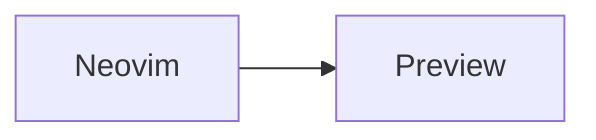

# md-peek.nvim

Write Markdown in Neovim and read it in a fast browser preview that stays in sync with every edit—chromeless in Chromium, or in a dedicated Firefox window.

`md-peek.nvim` follows the same philosophy as [`ipynb-peek.nvim`](https://github.com/AmaneKai/ipynb-peek.nvim): Neovim is the editor, a small browser window is the renderer, and the boundary between them should feel nearly invisible. It brings the reading features of the [Markdown Viewer browser extension](https://github.com/simov/markdown-viewer) into that workflow without requiring a browser extension.

## Features

- Live preview of unsaved buffer changes, debounced as you type
- Two-way source synchronization:
  - moving the Neovim cursor reveals and highlights the corresponding rendered block
  - clicking a rendered block moves the Neovim cursor to its source line
- GitHub-flavored Markdown: tables, task lists, autolinks, strikethrough, and fenced code
- Syntax highlighting for every language you have a Tree-sitter parser for, using your own parsers, plus one-click code copying
- A `nvim` theme that takes its colors from your active colorscheme and follows `:colorscheme` changes live
- LaTeX math (`$...$`, `$$...$$`, `\(...\)`, `\[...\]`) rendered as native MathML by a small Lua translator: fractions, roots, scripts, big operators with limits, accents, matrices, fonts and Greek, with no JavaScript or font bundle. Prices such as `$5 or $10` are left alone. Needs a browser with MathML Core (Chrome 109+, Firefox, Safari)
- `mermaid` and `mmd` fenced blocks render as diagrams: the Mermaid bundle is downloaded once with `curl` into Neovim's cache directory and served from there (offline or without curl they stay as source); click a diagram to zoom and pan
- Images are revalidated with `ETag`, and an image edited on disk gets a new URL on the next render, so it refreshes without reloading the page
- Nothing is compiled while no browser is connected
- `:emoji:` shortcodes, footnotes, YAML front matter, and GitHub-style alerts
- Generated, collapsible table of contents with stable heading anchors
- Neovim-native live status HUD and floating Markdown outline
- Local relative images, click-to-zoom, and lazy loading
- Clickable task lists: click a `- [ ]` checkbox in the preview to toggle it in the buffer
- Click any list item or table row to jump to exactly that line
- Link diagnostics: missing local files and unknown `#anchors` show up as Neovim warnings
- Relative links to other Markdown files open those files in Neovim
- Raw/rendered view toggle
- Reading-progress bar, preserved scroll position across edits, light/dark toggle (remembered per port, so set `port` to keep it between sessions), print/save-to-PDF, and HTML export
- Raw HTML is reduced to a strict tag and attribute allowlist; `<details>` bodies are compiled as Markdown
- Large media is streamed in chunks with HTTP `Range` support, so video seeking works and Neovim never blocks on a big file
- Built-in `dark`, `github`, `tokyonight`, `gruvbox`, `rose-pine` and `nvim` themes, plus color/font/CSS overrides
- Responsive layout for narrow popup windows
- Zero dependencies and no build step: the server, Markdown compiler and viewer page are all Lua inside Neovim; no CDN scripts or styles
- Token-protected loopback server, sanitized raw HTML, strict CSP, and no public network listener

Browser-extension-only concerns such as remote-origin permissions, response `Content-Type` detection, page encoding overrides, and CSP rewriting do not apply: md-peek renders the current Neovim buffer directly.

## Requirements

- Neovim 0.10+ (nothing else: no Node.js, npm, or compiler)
- Chrome, Brave, Edge, Chromium, or Firefox

`browser = "auto"` prefers Chromium's chromeless app mode and falls back to Firefox. Firefox supports every rendering and synchronization feature, but Firefox does not expose a Chromium-style `--app` mode, so its dedicated preview retains normal browser chrome. Run `:checkhealth md-peek` to inspect the setup.

Chromium previews reuse one isolated profile under Neovim's cache directory (so opening skips first-run setup), falling back to a throwaway profile if another Neovim holds it; Firefox uses a temporary profile each time. Either way the browser runs as an attached Neovim job. Closing the preview or exiting Neovim therefore stops only the browser instance owned by md-peek; it does not close the user's normal browser session.

## Installation

With lazy.nvim:

```lua
{
  "AmaneKai/md-peek.nvim",
  ft = { "markdown", "mdx" },
  cmd = { "MdPeekOpen", "MdPeekClose", "MdPeekToggle", "MdPeekRefresh", "MdPeekOutline", "MdPeekUrl" },
  config = function()
    require("md-peek").setup()
  end,
}
```

With packer.nvim:

```lua
use({
  "AmaneKai/md-peek.nvim",
  config = function()
    require("md-peek").setup()
  end,
})
```

There is nothing to build. For a manual install, put the plugin on your `runtimepath` and call:

```lua
require("md-peek").setup()
```

## Project layout

```text
lua/md-peek/
  init.lua        setup and commands; the session state machine, event handling, buffer wiring
  config.lua      default options
  server.lua      in-process vim.uv HTTP + SSE server: the page, /asset (Range, ETag), /mermaid.js, events
  compiler.lua    GitHub-flavoured Markdown to HTML, with data-source-line on every block
  math.lua        LaTeX to MathML translator
  highlight.lua   Tree-sitter code highlighting and the `nvim` colorscheme theme
  page.lua        the single viewer page: CSS, and the script that sanitizes (<template>), builds the
                  TOC, patches the DOM, draws Mermaid and handles clicks
  browser.lua     finding browsers, launching the preview window, moving and closing it
  overlay.lua     the heading scanner, the status HUD and the outline popup
  diagnostics.lua missing links/images and unknown #anchors as vim.diagnostic
  health.lua      :checkhealth md-peek
tests/            headless-Neovim smoke tests (units, a real TCP server, and Chrome when present)
```

## Usage

Open a Markdown buffer and run:

```vim
:MdPeekOpen
```

Available commands:

| Command          | Action                                             |
| ---------------- | -------------------------------------------------- |
| `:MdPeekOpen`    | Open the current Markdown buffer's preview         |
| `:MdPeekClose`   | Close the window and stop its local server         |
| `:MdPeekToggle`  | Toggle the preview                                 |
| `:MdPeekRefresh` | Force an immediate full render                     |
| `:MdPeekOutline` | Open a floating heading outline inside Neovim      |
| `:MdPeekUrl`     | Copy and show the preview address (for remote use) |

Default buffer-local mappings:

| Mapping      | Action                  |
| ------------ | ----------------------- |
| `<leader>mo` | Open                    |
| `<leader>mc` | Close                   |
| `<leader>mp` | Toggle                  |
| `<leader>mr` | Refresh                 |
| `<leader>mm` | Open the Neovim outline |

There is one preview window at a time, and it **follows you**: when you enter another Markdown buffer the same window switches to that document at once, with no restart. `:MdPeekOpen` on another buffer does the same. Set `follow = false` to switch only when you ask. Following keeps popup ownership, relative assets, and cursor synchronization unambiguous because the window always shows exactly the buffer you are in.

### Remote use (SSH, containers)

Over SSH, or on a machine with no display, md-peek does not try to start a browser. It prints the preview address and copies it to the clipboard instead; `:MdPeekUrl` does the same later. The server listens on `127.0.0.1` only, so forward its port to the machine with your browser. Pick a fixed port so the forward is stable:

```lua
require("md-peek").setup({ port = 8765 })
```

```sh
ssh -L 8765:127.0.0.1:8765 your-server   # then open the copied address locally
```

The address includes the session token, which is what authorises the connection. Set `browser = "none"` to never launch a browser, even locally.

## Configuration

Every field is optional; these are the defaults:

```lua
require("md-peek").setup({
  debounce_ms = 80,
  cursor_debounce_ms = 45,
  auto_open = false,
  follow = true, -- keep the preview on whichever Markdown buffer you are in
  port = 0, -- 0 picks a free port; set one to forward it over SSH
  diagnostics = true, -- warn about missing link/image files and unknown #anchors while previewing
  debug = false, -- notify how long opening takes and how long each render takes
  browser = "auto", -- auto, chromium, firefox, or none (never launch; use :MdPeekUrl)

  window = { width = 1100, height = 1000 },
  position = { x = 40, y = 40 },

  nvim = {
    status_overlay = false, -- opt-in live preview/section/progress HUD
    status_width = 42,
    outline_width = 76,
    outline_height = 20,
    border = "rounded",
    winblend = 6,
  },

  keymaps = {
    open = "<leader>mo",
    close = "<leader>mc",
    toggle = "<leader>mp",
    refresh = "<leader>mr",
    outline = "<leader>mm",
  },

  preview = {
    theme = "dark", -- dark, github, tokyonight, gruvbox, rose-pine, nvim (your colorscheme)
    toc = true,
    toc_open = false, -- initial sidebar state; the toolbar button still toggles it
    mermaid = true, -- diagrams (the bundle is downloaded once with curl)
    math = true, -- LaTeX math as native MathML
    emoji = true,
    raw_toggle = true,
    code_copy = true,
    scroll_sync = true,
    preserve_scroll = true,

    -- Markdown compiler options
    breaks = false,
    linkify = true,
    typographer = false,
    allow_html = true,
    sanitize = true,
    remote_images = true, -- false blocks http(s) images through the CSP
    -- Local files a document may embed: "git" (the enclosing repository, or the document's own
    -- folder when it is not in one), "document" (its folder and below), or an absolute directory
    -- path. Only images, audio, video and PDFs are served.
    asset_root = "git",

    max_width = 920,
    font = {
      -- ui = "Inter, sans-serif",
      -- mono = "JetBrains Mono, monospace",
      -- size = 16,
    },
    colors = {
      -- bg = "#17191d",
      -- fg = "#d7dae0",
      -- surface = "#20232a",
      -- border = "#353a45",
      -- muted = "#8b93a5",
      -- accent = "#70a5eb",
      -- heading = "#edf1f7",
      -- code = "#242830",
    },
    custom_css = "",
  },
})
```

Set a mapping to `false` or an empty string to disable it. Configuration that changes the frontend is applied when the preview server starts; close and reopen an existing preview after changing it.

## Markdown extras

GitHub-style alerts:

> [!NOTE]
> The preview follows your cursor.

Math:

Euler's identity is $e^{i\pi} + 1 = 0$, and

$$
\begin{pmatrix} a & b \\ c & d \end{pmatrix}
$$



## How it works

Opening a preview starts a small HTTP server inside Neovim itself (`vim.uv`, bound to `127.0.0.1` on an operating-system-assigned port unless you set `port`). Nothing runs as a separate process. The browser loads one self-contained page and then listens on a Server-Sent Events stream (`/events`); every render is compiled by `compiler.lua` in Neovim and pushed down that stream, and browser clicks come back as small `POST /act` requests that become the same events Neovim has always handled (`jump`, `toggle_task`, `open_file`).

The compiler turns Markdown into HTML with a `data-source-line` on each block, list item and table row, which is what makes cursor and click synchronisation exact. Fenced code is highlighted with Neovim's own Tree-sitter parsers (`vim.treesitter`), so any language you can highlight in Neovim is highlighted in the preview. In the browser each update is **patched** into the page: blocks that did not change keep their DOM nodes, so scroll position and selection survive an edit.

The session token is freshly generated for each preview and required by the page and the asset endpoint. Raw HTML is sanitized by default, and the page uses a restrictive Content Security Policy. Relative local assets are served only through the token-authenticated preview session, and only if they are images, audio, video or PDFs inside the allowed root. By default that root is the enclosing git repository (so `../screenshots/a.png` works), or the document's own directory when it is not in one; `preview.asset_root = "document"` narrows it to the document's folder, and an absolute path names a directory instead. A list such as `{ "git", "~/Pictures", "$XDG_DATA_HOME/img" }` allows several places at once (the repository, or the document's folder, plus each directory); `~` and `$VAR` are expanded and directories that do not exist on a machine are skipped, so the same dotfiles work everywhere. Parent traversal and symlinks that resolve outside the root are rejected, and the file type is judged by the real file, so a `.png` link to a secret is refused.

## Development

```sh
make format      # stylua
make check       # stylua --check, then the smoke tests
make testlua     # headless Neovim smoke tests (unit tests plus a real loopback server)
                 # also prints a 5,000-line compile benchmark and fails if a one-line edit takes 15 ms or more
```

The smoke tests cover the highlighter, the Markdown compiler (including XSS sanitisation), and the HTTP/SSE server over real sockets: token checks, event streaming, the `/act` validation and the `/asset` sandbox. CI runs them on Ubuntu, macOS, and Windows.

## License

MIT
