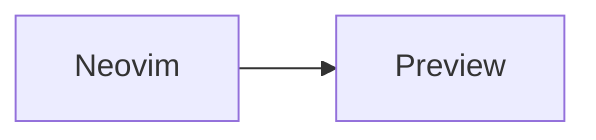

# md-peek.nvim

Write Markdown in Neovim and read it in a fast browser preview that stays in sync with every edit—chromeless in Chromium, or in a dedicated Firefox window.

`md-peek.nvim` follows the same philosophy as [`ipynb-peek.nvim`](https://github.com/AmaneKai/ipynb-peek.nvim): Neovim is the editor, a small browser window is the renderer, and the boundary between them should feel nearly invisible. It brings the reading features of the [Markdown Viewer browser extension](https://github.com/simov/markdown-viewer) into that workflow without requiring a browser extension.

## Features

- Live preview of unsaved buffer changes, debounced as you type
- Two-way source synchronization:
  - moving the Neovim cursor reveals and highlights the corresponding rendered block
  - clicking a rendered block moves the Neovim cursor to its source line
- GitHub-flavored Markdown: tables, task lists, autolinks, strikethrough, and fenced code
- Syntax highlighting with automatic language detection and one-click code copying
- KaTeX math using `$...$`, `$$...$$`, `\(...\)`, and `\[...\]`
- Mermaid diagrams from `mermaid` or `mmd` fenced blocks
- `:emoji:` shortcodes, footnotes, YAML front matter, and GitHub-style alerts
- Generated, collapsible table of contents with stable heading anchors
- Neovim-native live status HUD and floating Markdown outline
- Local relative images, click-to-zoom, and lazy loading
- Clickable task lists: click a `- [ ]` checkbox in the preview to toggle it in the buffer
- Click any list item or table row to jump to exactly that line
- Link diagnostics: missing local files and unknown `#anchors` show up as Neovim warnings
- Relative links to other Markdown files open those files in Neovim
- Raw/rendered view toggle
- Remembered reader theme and preserved scroll position
- Reading progress, print/save-to-PDF, and HTML export
- Built-in `dark`, `github`, `tokyonight`, `gruvbox`, and `rose-pine` themes, plus color/font/CSS overrides
- Responsive layout for narrow popup windows
- Offline, self-contained renderer after installation; no CDN scripts or styles
- Token-protected loopback server, sanitized raw HTML, strict CSP, and no public network listener

Browser-extension-only concerns such as remote-origin permissions, response `Content-Type` detection, page encoding overrides, and CSP rewriting do not apply: md-peek renders the current Neovim buffer directly.

## Requirements

- Neovim 0.10+
- Node.js 22.18+ (or 24.2+)
- Chrome, Brave, Edge, Chromium, or Firefox

`browser = "auto"` prefers Chromium's chromeless app mode and falls back to Firefox. Firefox supports every rendering and synchronization feature, but Firefox does not expose a Chromium-style `--app` mode, so its dedicated preview retains normal browser chrome. Run `:checkhealth md-peek` to inspect the setup.

Chromium previews reuse one isolated profile under Neovim's cache directory (so opening skips first-run setup), falling back to a throwaway profile if another Neovim holds it; Firefox uses a temporary profile each time. Either way the browser runs as an attached Neovim job. Closing the preview or exiting Neovim therefore stops only the browser instance owned by md-peek; it does not close the user's normal browser session.

## Installation

With lazy.nvim:

```lua
{
  "AmaneKai/md-peek.nvim",
  build = "cd server && npm install --omit=dev",
  ft = { "markdown", "mdx" },
  cmd = { "MdPeekOpen", "MdPeekClose", "MdPeekToggle", "MdPeekRefresh", "MdPeekOutline", "MdPeekUrl" },
  config = function()
    require("md-peek").setup()
  end,
}
```

With packer.nvim:

```lua
use({
  "AmaneKai/md-peek.nvim",
  run = "cd server && npm install --omit=dev",
  config = function()
    require("md-peek").setup()
  end,
})
```

For a manual install, run `npm install --omit=dev` inside the plugin's `server/` directory, then call:

```lua
require("md-peek").setup()
```

## Project layout

```text
lua/md-peek/
  init.lua        setup and commands; wires the session to buffers, server and browser
  session.lua     the preview lifecycle as a state machine (idle, starting, active, stopping, error)
  config.lua      default options
  server.lua      owns the Node job: starts it, waits for its `ready` line, relays events
  events.lua      reacts to events from the preview (jump, open_file, toggle_task, rendered)
  client.lua      send + debounce helpers
  diagnostics.lua missing links/images and unknown #anchors as vim.diagnostic
  markdown.lua    is this buffer Markdown?
  browser/        init.lua (open/close), detect.lua (find installs), profile.lua, process.lua
    drivers/      base.lua (the contract), chromium.lua, firefox.lua
    windows/      per-OS window control: osascript, xdotool, wmctrl, powershell
  overlay/        headings.lua, status.lua (HUD), outline.lua, ui.lua
  health.lua      :checkhealth md-peek
server/src/
  core/           daemon.ts (entry; wires everything), security.ts, links.ts
  http/           router.ts, static-handler.ts, asset-handler.ts, asset-path.ts (the sandbox)
  ws/             gateway.ts (browser connections)
  protocol.ts     zod schemas for every message
  client/         the browser app, bundled to dist/client.js
    store.ts      state + actions (a pure reducer; modules subscribe to changes)
    render/       the pipeline: parse -> sanitize -> patch -> enrich (math, diagrams, links)
server/dist/      committed build output; regenerate with `make build`
tests/            headless-Neovim smoke tests
```

## Usage

Open a Markdown buffer and run:

```vim
:MdPeekOpen
```

Available commands:

| Command          | Action                                             |
| ---------------- | -------------------------------------------------- |
| `:MdPeekOpen`    | Open the current Markdown buffer's preview         |
| `:MdPeekClose`   | Close the window and stop its local server         |
| `:MdPeekToggle`  | Toggle the preview                                 |
| `:MdPeekRefresh` | Force an immediate full render                     |
| `:MdPeekOutline` | Open a floating heading outline inside Neovim      |
| `:MdPeekUrl`     | Copy and show the preview address (for remote use) |

Default buffer-local mappings:

| Mapping      | Action                  |
| ------------ | ----------------------- |
| `<leader>mo` | Open                    |
| `<leader>mc` | Close                   |
| `<leader>mp` | Toggle                  |
| `<leader>mr` | Refresh                 |
| `<leader>mm` | Open the Neovim outline |

There is one preview window at a time, and it **follows you**: when you enter another Markdown buffer the same window switches to that document at once, with no restart. `:MdPeekOpen` on another buffer does the same. Set `follow = false` to switch only when you ask. Following keeps popup ownership, relative assets, and cursor synchronization unambiguous because the window always shows exactly the buffer you are in.

### Remote use (SSH, containers)

Over SSH, or on a machine with no display, md-peek does not try to start a browser. It prints the preview address and copies it to the clipboard instead; `:MdPeekUrl` does the same later. The server listens on `127.0.0.1` only, so forward its port to the machine with your browser. Pick a fixed port so the forward is stable:

```lua
require("md-peek").setup({ port = 8765 })
```

```sh
ssh -L 8765:127.0.0.1:8765 your-server   # then open the copied address locally
```

The address includes the session token, which is what authorises the connection. Set `browser = "none"` to never launch a browser, even locally.

## Configuration

Every field is optional; these are the defaults:

```lua
require("md-peek").setup({
  -- Discovered from the plugin's install path. Usually leave this nil.
  server_dir = nil,

  debounce_ms = 80,
  cursor_debounce_ms = 45,
  startup_timeout_ms = 10000,
  auto_open = false,
  follow = true, -- keep the preview on whichever Markdown buffer you are in
  port = 0, -- 0 picks a free port; set one to forward it over SSH
  diagnostics = true, -- warn about missing link/image files and unknown #anchors while previewing
  debug = false, -- notify how long opening takes and how long each render takes
  browser = "auto", -- auto, chromium, firefox, or none (never launch; use :MdPeekUrl)

  window = { width = 1100, height = 1000 },
  position = { x = 40, y = 40 },

  nvim = {
    status_overlay = false, -- opt-in live preview/section/progress HUD
    status_width = 42,
    outline_width = 76,
    outline_height = 20,
    border = "rounded",
    winblend = 6,
  },

  keymaps = {
    open = "<leader>mo",
    close = "<leader>mc",
    toggle = "<leader>mp",
    refresh = "<leader>mr",
    outline = "<leader>mm",
  },

  preview = {
    theme = "dark", -- dark, github, tokyonight, gruvbox, rose-pine
    toc = true,
    toc_open = false, -- initial sidebar state; the toolbar button still toggles it
    math = true,
    mermaid = true,
    emoji = true,
    raw_toggle = true,
    code_copy = true,
    scroll_sync = true,
    preserve_scroll = true,

    -- Markdown compiler options
    breaks = false,
    linkify = true,
    typographer = false,
    allow_html = true,
    sanitize = true,
    remote_images = true, -- false blocks http(s) images through the CSP
    -- Local files a document may embed: "document" (its folder and below), "git" (the whole
    -- repository), or an absolute directory path. Only images, audio, video and PDFs are served.
    asset_root = "document",

    max_width = 920,
    font = {
      -- ui = "Inter, sans-serif",
      -- mono = "JetBrains Mono, monospace",
      -- size = 16,
    },
    colors = {
      -- bg = "#17191d",
      -- fg = "#d7dae0",
      -- surface = "#20232a",
      -- border = "#353a45",
      -- muted = "#8b93a5",
      -- accent = "#70a5eb",
      -- heading = "#edf1f7",
      -- code = "#242830",
    },
    custom_css = "",
  },
})
```

Set a mapping to `false` or an empty string to disable it. Configuration that changes the frontend is applied when the preview server starts; close and reopen an existing preview after changing it.

## Markdown extras

Mermaid:



Math:

Euler's identity is $e^{i\pi} + 1 = 0$.

$$
\int_0^1 x^2\,dx = \frac{1}{3}
$$

GitHub-style alerts:

> [!NOTE]
> The preview follows your cursor.

## How it works

Opening a preview starts one Node process bound to `127.0.0.1` on an operating-system-assigned port. Neovim and that attached child process exchange newline-delimited JSON through persistent standard input and output streams, so live updates do not start per-edit processes or make local HTTP requests. The server announces itself with a single `{"type":"ready",...}` line; Neovim reacts to it directly instead of polling, and treats an early exit or a timeout as a startup failure. The browser receives updates over a WebSocket, and browser clicks return through the same Node job channel.

Each render runs through a small pipeline in the browser: the Markdown is parsed (front matter first, with line endings normalised so source lines stay exact), the HTML is sanitized, and it is then **patched** into the page. Blocks that did not change keep their DOM nodes, so rendered diagrams, math, zoom and selection survive an edit; only new or changed blocks are enriched with math, diagrams and link handling.

The session token is freshly generated for each preview and required by the page and the asset endpoint. Raw HTML is sanitized by default, and the page uses a restrictive Content Security Policy. Relative local assets are served only through the token-authenticated preview session, and only if they are images, audio, video or PDFs inside the allowed root. By default that root is the Markdown document's own real directory; `preview.asset_root = "git"` widens it to the enclosing repository, or to a directory you name. Parent traversal and symlinks that resolve outside the root are rejected, and the file type is judged by the real file, so a `.png` link to a secret is refused.

The browser renderer and its math fonts are committed in `server/dist/`; runtime rendering never fetches libraries from a CDN. KaTeX is loaded from a local chunk, and Mermaid from a single local file, only when the active document needs them.

## Development

```sh
make build       # rebuild server/dist
make check       # formatting, lint, types, build, then every test
make testlua     # headless Neovim smoke test
make testserver  # server, protocol, store/pipeline and real-browser tests
make checkbuild  # fail if the committed server/dist does not match the source
```

The real-browser tests (Chrome click-to-source and in-place patching, a committed DOM snapshot, a Firefox load test) use whichever of Chrome and Firefox is installed and skip themselves otherwise. Set `MD_PEEK_CHROME` or `MD_PEEK_FIREFOX` to point at a specific binary. They run against `server/dist`, so build first.

CI runs the Lua launch and cleanup smoke tests on Ubuntu, macOS, and Windows. The server and browser-client suite runs on Ubuntu.

## License

MIT
