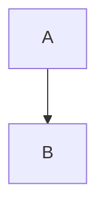

# Title

Intro paragraph with **bold**, `code`, :smile: and a [link](other.md#x) and [web](https://example.com).

## Lists

- one
  - nested a
  - nested b
- two

1. first
2. second

- [x] done
- [ ] todo

## Table

| a | b |
| - | - |
| 1 | 2 |
| 3 | 4 |

> [!NOTE]
> An alert.

## Code

```js
const x = 1
```



Math: $a^2+b^2=c^2$ and

$$
\int_0^1 x\,dx
$$


Footnote[^1].

[^1]: The note.
